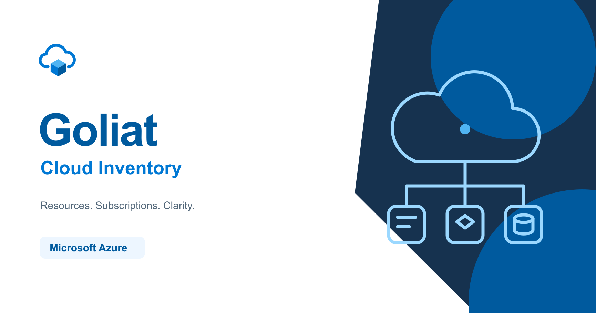

# Goliat - Cloud Inventory

[](https://github.com/danieljsaldana/goliat-cloud-inventory/actions/workflows/dashboard-check.yml)
[](LICENSE)
[](package.json)
[](https://nextjs.org/)

**Web:** <https://danieljsaldana.github.io/goliat-cloud-inventory/> · **English:** [README.md](README.md)

Goliat es un **dashboard autoalojado de inventario y FinOps de Microsoft Azure**. Una Azure Function recoge los recursos de una o varias suscripciones mediante Azure Resource Graph y ARM, publica un único snapshot JSON en Blob Storage y un backend Next.js lo importa en PostgreSQL. La web (español e inglés) ofrece **73 vistas en 12 grupos de servicios**, gráficas interactivas, búsqueda global, gestión de etiquetas, análisis de gastos reales desde Azure Cost Management y un panel de administración del colector.



## Funcionalidades

- **Inventario**: [73 vistas en 12 grupos de servicios](docs/azure-services.md) (cómputo, contenedores, web, red, almacenamiento, bases de datos, seguridad, integración, monitorización, etiquetas…). Cada categoría tiene un **Resumen** con indicadores, gráficas interactivas y recursos únicos; cada tabla de detalle admite filtro por suscripción, búsqueda, filtros de columna, agrupación, orden, paginación y exportación.
- **Búsqueda global** (`Ctrl+K` / `⌘K`): recursos por nombre, ID, etiqueta o suscripción, además de suscripciones y vistas, sobre todo el inventario cargado y sin peticiones adicionales a la nube.
- **FinOps** ([docs/finops.md](docs/finops.md)): gastos reales o amortizados de Azure Cost Management con filtros de mes, suscripción y moneda, evolución diaria, distribución por servicio y detalle por recurso. Los datos ausentes, los permisos insuficientes y los resultados parciales se muestran de forma explícita, nunca como «coste cero». Las monedas no se mezclan.
- **Administración** ([docs/administration.md](docs/administration.md)): estado y métricas de la Function, salud de PostgreSQL y Blob Storage, comparación entre el inventario publicado y el importado, programación del timer y claves de etiquetas mostradas como columnas.
- **Miembros** ([docs/members.md](docs/members.md)): gestión opcional de roles respaldada por Entra ID y PostgreSQL.
- **Vista Arquitectura**: diagramas interactivos del flujo de la aplicación y del despliegue Azure, generados desde JSON ([docs/architecture.json](docs/architecture.json), [docs/azure-deployment.json](docs/azure-deployment.json)).
- **Autenticación**: Microsoft Entra ID (un solo tenant, PKCE, Auth.js) o un modo demo con usuario y contraseña. Las páginas y las API de datos se protegen en el servidor.
- **Snapshots atómicos**: cada importación es una transacción PostgreSQL; un fallo conserva el snapshot anterior. El mismo ETag del blob nunca se importa dos veces.
- **i18n**: catálogos en español e inglés para toda la interfaz; los identificadores y valores de Azure se conservan tal cual.

## Arquitectura

```text
Azure Function (timer / cola / HTTP autenticado)
        │  Resource Graph + ARM, identidad administrada
        ▼
Blob Storage  ──  azure/latest.json (schemaVersion 2, ETag)
        │  identidad de solo lectura
        ▼
Backend Next.js  ──  normalizador → snapshot en PostgreSQL (una transacción)
        │
        ▼
Dashboard (React, shadcn/ui, Recharts)  ──  login Entra ID o demo
        │
        └──  FinOps → Azure Cost Management (identidad del servidor, Cost Management Reader)
```

El botón **Actualizar** solicita a la Function una nueva generación con un token de Entra, espera su publicación, importa el blob y recarga el dashboard. Un _advisory lock_ compartido de PostgreSQL permite una sola actualización manual a la vez para todos los usuarios y réplicas. Detalles en [docs/backend.md](docs/backend.md) y [docs/azure-function.md](docs/azure-function.md).

### Estructura del repositorio

| Ruta                    | Contenido                                                                                                                                                             |
| ----------------------- | --------------------------------------------------------------------------------------------------------------------------------------------------------------------- |
| `app/`                  | Next.js App Router: páginas, metadatos, login, documentos protegidos, API de lectura y actualización. El navegador nunca recibe credenciales cloud ni de BD.          |
| `src/`                  | Componentes, hooks, servicios y catálogos i18n del dashboard, organizados por funcionalidad. `src/core/` contiene modelos compartidos con los colectores (sin React). |
| `server/`               | Pool PostgreSQL, esquema y migraciones, autenticación, control de acceso, logs, FinOps, administración, bloqueo de actualización y comandos CLI.                      |
| `server/modules/azure/` | Lector de Blob Storage, normalizadores, consultas, repositorios y semilla del inventario Azure.                                                                       |
| `functions/`            | Productor independiente en Node.js para Azure Functions: timer, worker de cola, API autenticada y script de despliegue ([README](functions/README.md)).               |
| `iac/`                  | Bicep + PowerShell: grupo de recursos, Function App (Flex Consumption), Storage, App Service, PostgreSQL Flexible Server y registros de Entra.                        |
| `docs/`                 | Contrato del backend, guía de la Function, catálogo de servicios, FinOps, administración, miembros, identidad visual y diagramas de arquitectura.                     |
| `scripts/`              | Generación de diagramas, recursos de marca, sincronización del contrato de inventario y ejemplos.                                                                     |
| `tests/`                | Pruebas unitarias, de integración (PostgreSQL) y de navegador con Playwright.                                                                                         |

## Inicio rápido

Requisitos: **Node.js 24** (mínimo 22.12) y una base **PostgreSQL** vacía cuyo usuario pueda crear tablas.

```bash
npm ci
cp .env.example .env
# Editar DB_HOST, DB_NAME, DB_USER, DB_PASSWORD y DB_SSL. Para el login demo definir
# DASHBOARD_AUTH_MODE=demo, DASHBOARD_USERNAME, DASHBOARD_PASSWORD y un AUTH_SECRET de 32+ bytes.
npm run db:init   # crea el esquema desde server/schema/initial.sql (idempotente)
npm run db:seed   # opcional: 73 vistas, 5 suscripciones y 214 recursos ficticios, sin credenciales cloud
npm run dev
```

Abrir <http://127.0.0.1:4000>. `PORT` en `.env` define el puerto de `dev` y `start`; `server/start-next.mjs` carga el archivo antes de arrancar Next.js. Al cambiar el puerto, actualizar también `AUTH_URL` y `SITE_URL`.

Instalar las dependencias en el sistema operativo donde se ejecutará Next.js (los binarios nativos de Tailwind difieren entre Windows y Linux); Docker usa sus propios `node_modules`. `.env` nunca se versiona ni se copia en las imágenes. No usar prefijos `NEXT_PUBLIC_` para credenciales.

### Scripts

| Comando                                         | Propósito                                                                          |
| ----------------------------------------------- | ---------------------------------------------------------------------------------- |
| `npm run dev` / `start`                         | Servidor de desarrollo / producción (carga `.env` primero).                        |
| `npm run build`                                 | Compilación de producción (salida standalone).                                     |
| `npm run db:init`                               | Crea el esquema en una base vacía; se puede repetir.                               |
| `npm run db:seed`                               | Carga el inventario de demostración (rechaza `NODE_ENV=production`).               |
| `npm run db:migrate` / `db:status` / `db:check` | Aplica, lista y verifica migraciones.                                              |
| `npm run collect:azure`                         | Importa `azure/latest.json` de Blob Storage en PostgreSQL.                         |
| `npm test`                                      | Pruebas unitarias; integración PostgreSQL con `RUN_DB_TESTS=1`.                    |
| `npm run test:functions`                        | Pruebas del productor de Azure Functions.                                          |
| `npm run test:e2e`                              | Pruebas de navegador con Playwright (compila y arranca Next.js en el puerto 4100). |
| `npm run lint` / `format` / `format:check`      | ESLint (hooks, capas, sin `let` ni ternarios anidados) y Prettier.                 |
| `npm run docs:diagram`                          | Regenera `docs/architecture.html` y `docs/azure-deployment.html`.                  |
| `npm run assets:brand`                          | Regenera logo, favicon, icono Apple y portada social.                              |

## Configuración

Todas las variables están documentadas en [.env.example](.env.example). Los grupos principales:

| Grupo         | Variables                                                                                                                                                                                                                                |
| ------------- | ---------------------------------------------------------------------------------------------------------------------------------------------------------------------------------------------------------------------------------------- |
| Web           | `PORT`, `SITE_URL`, `INVENTORY_REFRESH_TIMEOUT_MS` (máx. 900000), `INVENTORY_TAG_KEYS`                                                                                                                                                   |
| Logs          | `LOG_ENABLED`, `LOG_LEVEL` (`info` \| `warn` \| `error`), `LOG_HTTP_ENABLED`                                                                                                                                                             |
| Autenticación | `DASHBOARD_AUTH_ENABLED`, `DASHBOARD_AUTH_MODE` (`demo` \| `azure-ad`), `AUTH_SECRET`, `AUTH_URL`, `DASHBOARD_USERNAME`, `DASHBOARD_PASSWORD`, `AUTH_MICROSOFT_ENTRA_ID_*`, `DASHBOARD_ADMIN_OBJECT_IDS`, `DASHBOARD_MEMBERS_ENABLED`    |
| PostgreSQL    | `DB_HOST`, `DB_PORT`, `DB_NAME`, `DB_USER`, `DB_PASSWORD`, `DB_POOL_SIZE`, `DB_QUERY_TIMEOUT_MS`, `DB_SSL`, `DB_SSL_CA_PATH`, `DB_MIGRATION_*`                                                                                           |
| Azure Storage | `AZURE_AUTH_MODE` (`default` \| `client-secret` \| `managed-identity`), `AZURE_TENANT_ID`, `AZURE_CLIENT_ID`, `AZURE_CLIENT_SECRET`, `AZURE_STORAGE_ACCOUNT_URL`, `AZURE_STORAGE_CONTAINER`, `AZURE_STORAGE_BLOB`, `AZURE_MAX_OBJECT_MB` |
| Function      | `AZURE_FUNCTION_BASE_URL`, `AZURE_FUNCTION_SCOPE`, `AZURE_FUNCTION_RESOURCE_ID`, `AZURE_POSTGRES_RESOURCE_ID`, `AZURE_STORAGE_RESOURCE_ID`                                                                                               |
| FinOps        | `FINOPS_AUTH_MODE`, `FINOPS_SUBSCRIPTION_IDS` (máx. 20; vacío reutiliza el catálogo del inventario)                                                                                                                                      |

### Autenticación

`DASHBOARD_AUTH_ENABLED=true` (valor predeterminado) exige sesión en las páginas y en las API de datos. Una configuración incompleta o inválida bloquea el acceso; nunca activa el modo público automáticamente.

- `DASHBOARD_AUTH_MODE=demo` usa `DASHBOARD_USERNAME` / `DASHBOARD_PASSWORD` con una pantalla de acceso que funciona también sin JavaScript.
- `DASHBOARD_AUTH_MODE=azure-ad` usa Microsoft Entra ID mediante Auth.js (NextAuth 5). Registrar una aplicación **web** con el callback `<AUTH_URL>/api/auth/callback/microsoft-entra-id` y definir `AUTH_MICROSOFT_ENTRA_ID_ID`, `AUTH_MICROSOFT_ENTRA_ID_SECRET` y `AUTH_MICROSOFT_ENTRA_ID_ISSUER=https://login.microsoftonline.com/<tenant-id>/v2.0`. Solo se admite ese tenant. La foto del usuario se consulta una vez al iniciar sesión desde Microsoft Graph con el permiso delegado `User.Read` y se conserva como miniatura de 48×48 en la sesión.

Las sesiones son cookies JWT (`HttpOnly`, `SameSite=Lax`, 8 horas). `AUTH_SECRET` necesita al menos 32 bytes aleatorios; `AUTH_URL` fija el origen canónico. Cambiar el modo invalida las sesiones existentes. Las credenciales del dashboard son independientes de las del colector.

### PostgreSQL y TLS

Para un servidor local sin TLS usar `DB_SSL=false`. Con `DB_SSL=true` se verifican el certificado y el nombre del servidor con las CA del sistema; indicar `DB_SSL_CA_PATH` (PEM) si el servidor usa una CA propia y montarla en el contenedor. El proceso web necesita DML; el migrador necesita DDL y puede usar otro usuario (`DB_MIGRATION_*`). Ejecutar las migraciones como job previo al despliegue, nunca automáticamente al arrancar cada réplica.

### Logs

Los mensajes del backend se emiten como JSON a `stderr` con [Pino](https://github.com/pinojs/pino). Cada resumen de API incluye ruta, estado, duración y `requestId` (devuelto también en `X-Request-ID`); las peticiones superiores a un segundo producen una advertencia. No se registran cuerpos, cookies, tokens, parámetros de consulta ni SQL; los errores externos conservan tipo y código sin mensaje ni stack. Los comandos CLI escriben su resultado JSON en `stdout`.

## Ingerir Azure

```bash
npm run collect:azure
```

Configurar `AZURE_STORAGE_ACCOUNT_URL`, `AZURE_STORAGE_CONTAINER` y `AZURE_STORAGE_BLOB` (por defecto `azure/latest.json`). La identidad solo necesita lectura de blobs. El backend descarga el JSON con su ETag, valida la versión del contrato (`schemaVersion: 2`, 69 informes de origen más cuatro vistas calculadas por el backend), normaliza las 73 vistas y las publica en una transacción. La fecha mostrada procede del documento, no de la descarga.

El [productor de Functions](functions/README.md) publica el inventario completo con su propia identidad administrada: timer diario, worker de cola y `POST` autenticado con Entra para generar o publicar un documento. Cumple el [contrato JSON del backend](docs/backend.md#documento-azure-en-blob-storage); el dashboard obtiene las suscripciones y las claves de etiquetas del archivo. La [guía de desarrollo de la Function](docs/azure-function.md) detalla el formato y la integración con «Actualizar».

## Desplegar en Azure

Todo vive en un único grupo de recursos (`rg-goliat-dev` por defecto) y se opera desde la raíz del repositorio con PowerShell 5.1+ y Azure CLI:

```powershell
.\goliat.ps1 help      # no necesita configuración ni login
.\goliat.ps1 init      # crea iac/.env y el archivo privado del proyecto (ignorados por Git)
.\goliat.ps1 validate  # bicep build + what-if
.\goliat.ps1 deploy    # Storage, Function (Flex Consumption), App Service F1, PostgreSQL B1ms, registros Entra
.\goliat.ps1 stop | start | destroy-plan | destroy
```

`deploy-project.ps1` compila la web en Linux, inicializa la base y publica ambos proyectos; `-AuthMode demo|tenant` elige el login (tenant crea además la aplicación Entra y su callback). FinOps asigna **Cost Management Reader** a la identidad web en las suscripciones del inventario; Administración usa dos roles personalizados con permisos mínimos. Consulta [iac/COMMANDS.md](iac/COMMANDS.md), [iac/PROJECT.md](iac/PROJECT.md) e [iac/README.md](iac/README.md). Los secretos solo se escriben en `iac/.env` e `iac/.azure/*.local.json`, ambos ignorados por Git.

**`destroy` borra el grupo de recursos completo y sus datos sin confirmación adicional**; usa `-Confirm` para una confirmación interactiva.

## Docker

El Dockerfile tiene tres objetivos: `runner` (por defecto, web), `collector` (ingesta) y `migrator` (job previo al despliegue). Las imágenes usan salida standalone, Node.js 24 y un usuario sin privilegios; se construyen sin credenciales ni acceso a la base.

```bash
docker build -t cloud-inventory-web .
docker build --target collector -t cloud-inventory-collector .
docker build --target migrator  -t cloud-inventory-migrator .

docker run --rm --env-file .env -v "$PWD/certs:/app/certs:ro" cloud-inventory-migrator
docker run --rm --env-file .env -v "$PWD/certs:/app/certs:ro" cloud-inventory-collector azure
docker run -d --name cloud-inventory -p 4000:4000 --env-file .env -v "$PWD/certs:/app/certs:ro" cloud-inventory-web
```

`/api/health/` comprueba vida y `/api/ready/` comprueba base y esquema. [compose.example.yaml](compose.example.yaml) muestra la dependencia migrar-antes-de-servir. Usa `host.docker.internal` para llegar a un PostgreSQL del host.

## Pruebas

```bash
npm test               # unitarias (las de PostgreSQL se omiten salvo RUN_DB_TESTS=1)
npm run test:functions
npm run lint && npm run format:check && npm run build
```

Las pruebas de base de datos necesitan `RUN_DB_TESTS=1` y una base temporal cuyo nombre termine en `_test`; comprueban migraciones repetibles, publicación de las 73 vistas, semilla repetible, rollback y deduplicación. Las pruebas de navegador (`npx playwright install chromium && npm run test:e2e`) compilan y arrancan el servidor de producción en el puerto 4100 con su propia sesión demo, un esquema aleatorio y datos ficticios; cubren navegación, cambio ES/EN, filtros, gráficas, bloqueo de actualización para dos usuarios, FinOps, Administración y la vista Arquitectura en escritorio (español) y móvil (inglés).

El workflow de CI ([.github/workflows/dashboard-check.yml](.github/workflows/dashboard-check.yml)) selecciona las comprobaciones para pull requests y pushes a `main` según los archivos modificados. Los cambios solo de documentación comprueban formato; el código afectado ejecuta pruebas de la Function en Node 22 o unitarias, de PostgreSQL 17 y de navegador en Node 24, además de lint y CodeQL. El check obligatorio **CI** agrega los resultados. Las pruebas no necesitan secretos. Pages publica solo la web estática desde `main`, tras una CI correcta. Consulta [.github/WORKFLOWS.md](.github/WORKFLOWS.md).

Las pruebas simulan los SDK cloud y no ejecutan un login real contra Entra ID. Antes de producción, validar tenant, permisos, TLS de PostgreSQL y la identidad Azure del entorno, y definir una política de retención de snapshots y blobs.

## Notas de desarrollo

- Solo JavaScript/JSX; los contratos compartidos se documentan con JSDoc en archivos `types.js`.
- Un componente por carpeta (`index.jsx`); los hooks gestionan estado, cancelación y recarga; los servicios `api/` realizan las peticiones; `src/core/` no tiene React ni HTTP.
- UI: **shadcn/ui (New York, Radix UI)** adaptado en `src/components/ui/primitives/`, Tailwind CSS 4 y Recharts 3 mediante `ChartContainer`. Añade controles con `npx shadcn@latest add <componente>` y adáptalos a la estructura de carpetas y a i18n.
- `npm run lint` aplica las reglas de hooks y la separación de capas, y rechaza `let`, ternarios anidados y cadenas de promesas.
- Los diagramas se generan con [Archify](https://github.com/tt-a1i/archify) 3.0.1, incluido con sus licencias en `vendor/archify/`. El diagrama de despliegue es una instantánea de referencia del entorno `goliat-dev` predeterminado, no un descubrimiento en tiempo real.

## Seguridad

- Las credenciales cloud y de base de datos permanecen en el servidor; el navegador solo habla con las API del backend.
- Las API de datos devuelven `private, no-store`; las respuestas incluyen `X-Content-Type-Options: nosniff`, `X-Frame-Options: SAMEORIGIN` y una política de referrer restrictiva. El iframe de Arquitectura está aislado con sandbox.
- FinOps valida origen, credenciales en URL, ruta de suscripción y ciclos de paginación antes de enviar un token a ARM; aplica límites por proceso (dos consultas simultáneas, 50 000 filas, 8 MiB por resultado, 16 MiB de caché) y responde `429` con `Retry-After` al excederlos.
- Aviso conocido: `@azure/identity` 4.14 fija `@azure/msal-node` 6.x, afectado por [GHSA-xcx6-jx8p-x3h5](https://github.com/advisories/GHSA-xcx6-jx8p-x3h5) (flujo _authorization code_). Goliat solo usa credenciales de secreto de cliente e identidad administrada, por lo que ese flujo nunca se ejecuta; la dependencia se actualizará en cuanto exista una versión compatible.

Comunica las vulnerabilidades de forma privada mediante los avisos de seguridad de GitHub, no en issues públicas.

## Identidad visual

### Web del producto

La portada estática para GitHub Pages está en `site/index.html`. Comparte colores, fuentes
DM Sans alojadas localmente y patrones visuales con el dashboard. Las vistas de Inventario y
FinOps usan solo datos ficticios; no se conectan a Azure. El menú es navegable y utiliza los
214 recursos y cinco suscripciones de la semilla del repositorio. Incluye filtros por suscripción,
búsqueda por nombre, ID o etiqueta, paginación y detalle de recursos; en móvil se elige la vista
desde un selector. Las categorías se calculan con las mismas reglas del producto.
La paginación numerada reutiliza `pageItems` del producto: incluye primera y última página,
puntos suspensivos y controles compactos en móvil. El hover no sustituye a la selección
del menú y el foco de teclado queda dentro del botón, sin invadir las filas vecinas.
Los importes FinOps son una simulación determinista para tres meses, no datos de facturación.
Las pestañas **Usuarios** y **Admin** muestran un directorio sintético de seis cuentas y el estado
simulado de los servicios. Se pueden filtrar usuarios y confirmar cambios de rol, salvo en cuentas
protegidas o deshabilitadas; Administración permite guardar o descartar un horario de ejemplo.
Admin reutiliza los textos, períodos y reglas de sincronización del producto: gráficas con muestras
horarias e inspección por puntero/teclado, comparación de versiones, cron y edición de etiquetas.
PostgreSQL y Blob Storage tienen tarjetas independientes con métricas y detalles desplegables.
El selector de escenarios permite probar datos ausentes, una publicación pendiente de importar
y el bloqueo de edición durante una generación. Guardar etiquetas actualiza las columnas de la vista
Etiquetas de esta demo; la consulta simulada no hace peticiones a Azure.
Estos cambios solo viven en memoria y se restauran al recargar. No llaman a Graph ni a Azure.
La demo no permite modificar recursos ni iniciar recogidas. Sin JavaScript conserva la vista ilustrativa.
Incluye español e inglés,
navegación por teclado y diseño adaptable. Ejecuta `npm run test:site` tras instalar Chromium
de Playwright (`npx playwright install chromium`); no necesita PostgreSQL ni credenciales cloud.
Las capturas se guardan en `test-results/site/`. La licencia de la fuente está en `site/assets/DM-Sans-LICENSE.txt`.

El selector del visor Archify alterna entre la arquitectura de la aplicación y el despliegue
Azure de referencia. Actualiza el título, la ayuda y el enlace al documento completo; cambiar
el idioma conserva el diagrama seleccionado y su zoom.

Ejecuta `npm run build:site` antes de previsualizar o publicar: copia los dos documentos
Archify públicos a `site/assets/`, genera `demo-data.json` desde la semilla fija y copia los
helpers compartidos de agregación y paginación. No lee `.env` ni consulta Azure o PostgreSQL.
Los archivos generados se ignoran en Git. Tras editar
los JSON de los diagramas, ejecuta primero `npm run docs:diagram`. GitHub Pages realiza la copia automáticamente.
Activa **Settings → Pages → Source: GitHub Actions** para desplegar esta web estática; la aplicación Next.js
sigue necesitando un servidor Node.js y PostgreSQL.

Creado por [Daniel J. Saldaña](https://danieljsaldana.dev).

El logo combina una nube y un bloque isométrico de inventario en azul Azure. `npm run assets:brand` regenera logo, favicon, icono Apple y portada social; véase [docs/social-image.md](docs/social-image.md).

## Contribuciones y seguridad

Consulta [CONTRIBUTING.md](CONTRIBUTING.md) para preparar el entorno, ejecutar pruebas y enviar pull requests.
Comunica las vulnerabilidades de forma privada como se indica en [SECURITY.md](SECURITY.md).

## Licencia

[MIT](LICENSE) © Daniel J. Saldaña. Los avisos de terceros del renderizador de diagramas incluido están en [vendor/archify/THIRD_PARTY_NOTICES.md](vendor/archify/THIRD_PARTY_NOTICES.md).
