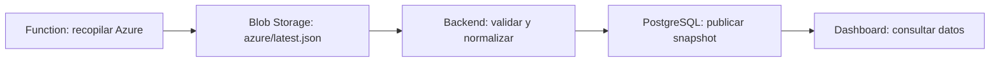
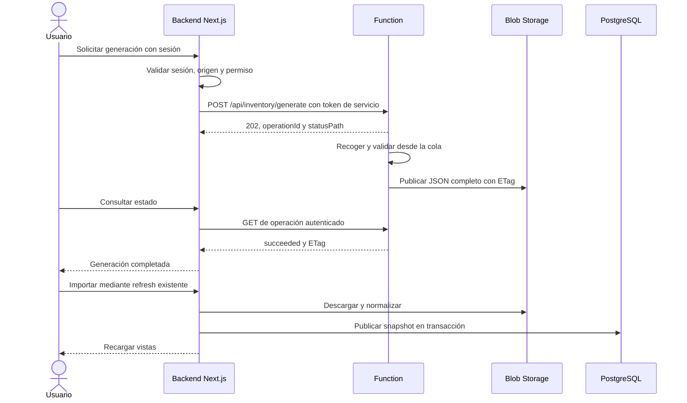

# Goliat - Cloud Inventory: desarrollar la Azure Function

Esta guía define la lógica del productor Azure y el fichero que debe publicar para que este dashboard lo pueda consumir. El código está en [functions/](../functions/README.md), como proyecto independiente de **Azure Functions y Azure Blob Storage**, con PostgreSQL como base del dashboard.

Están implementados el colector, el constructor y validador del documento, timer, worker de cola, publicación condicional, endpoints HTTP con validación JWT de Entra ID e integración con «Actualizar». El despliegue completo configura la aplicación API y concede a la identidad administrada de la web únicamente el rol `Inventory.Generate`.

La [carpeta `iac/`](../iac/README.md) crea y destruye el grupo, la Function App Flex Consumption y Storage con identidad administrada. [functions/deploy.ps1](../functions/deploy.ps1) reutiliza esa infraestructura y publica el código con un comando; [functions/README.md](../functions/README.md) explica despliegue, primera ejecución y desarrollo local.

## 1. Flujo actual y responsabilidad de la Function



La Function consulta Azure, construye una generación completa y la publica en Storage. El backend descarga ese documento, transforma 69 informes brutos en las 73 vistas del panel y guarda el resultado en PostgreSQL. La Function no necesita acceder a la base de datos del dashboard.

Actualmente:

- `npm run collect:azure` importa el fichero de Storage.
- `POST /api/inventory/azure/refresh/` exige sesión demo o Entra y origen válido. Solicita generación a la Function y devuelve `202` con `operationId`.
- El botón consulta `GET /api/inventory/azure/refresh/?operationId=<ID>` hasta que la Function confirme `succeeded`. Después envía POST a esa misma URL para importar el blob confirmado y recarga las vistas. Los GET no importan ni generan.
- Publicar un blob nuevo no actualiza PostgreSQL automáticamente: hace falta una ingesta posterior, manual o programada.

Referencias: [flujo de ingesta](../server/modules/azure/services/collectAzure.mjs), [endpoint actual](../app/api/inventory/azure/refresh/route.js) y [arquitectura del backend](backend.md).

## 2. Lógica que debe ejecutar el productor

Usar un caso de uso compartido, por ejemplo `generateInventory()`, que puedan invocar un trigger programado y otro HTTP. En Node.js, cada función registrada tiene un único trigger; los dos handlers pueden llamar al mismo servicio. Para un proyecto nuevo, Microsoft documenta el modelo de programación v4. [Referencia de Azure Functions para Node.js](https://learn.microsoft.com/en-us/azure/azure-functions/functions-reference-node).

La ejecución debe seguir este orden:

1. **Fijar el ámbito en configuración del servidor.** Definir tenant, suscripciones y claves de etiquetas. El inventario activo del dashboard es global; debe contener todas las suscripciones de ese ámbito.
2. **Coordinar ejecuciones.** Evitar que el trigger programado y el POST generen o publiquen a la vez sobre el mismo destino. El bloqueo actual de PostgreSQL solo coordina la importación manual del dashboard.
3. **Recopilar el catálogo de suscripciones**, incluidas las vacías y las deshabilitadas accesibles. Para las habilitadas, obtener todos los recursos y grupos de recursos del ámbito.
4. **Consultar Resource Graph y/o ARM**, recorriendo toda la paginación. Limitar la concurrencia y reintentar fallos transitorios y throttling. Enriquecer los detalles que necesite cada informe.
5. **Construir los 69 informes**, sus totales y agrupaciones de etiquetas a partir de la misma recogida. Distinguir «consulta correcta sin recursos» de «consulta fallida»: un fallo en una consulta necesaria impide publicar una generación completa.
6. **Asignar `generatedAt` al completar la recogida**, con `new Date().toISOString()`. Es una fecha de generación, no la fecha de descarga ni una garantía de lectura simultánea de todos los servicios Azure.
7. **Validar estructura y contenido**, normalizar de prueba y comprobar el tamaño en bytes UTF-8 antes de escribir.
8. **Publicar el documento completo** en el blob de lectura, conservando el anterior si falla cualquier paso previo. Registrar el ETag devuelto por Storage.
9. **Marcar la operación como completada después de confirmar la escritura.** A partir de entonces el backend puede importar la nueva generación.

No publicar un inventario parcial por cada suscripción en `latest.json`: la última escritura sustituiría todo el conjunto visible. Si se necesita recopilar en paralelo, unir los resultados antes de la publicación global.

## 3. Destino y formato del fichero

El consumidor está configurado en [.env.example](../.env.example):

```dotenv
AZURE_STORAGE_ACCOUNT_URL=https://your-account.blob.core.windows.net
AZURE_STORAGE_CONTAINER=cloud-inventory
AZURE_STORAGE_BLOB=azure/latest.json
AZURE_MAX_OBJECT_MB=64
```

`AZURE_STORAGE_ACCOUNT_URL` debe ser un endpoint HTTPS sin rutas, query strings ni credenciales. El nombre del blob es relativo al contenedor. La Function debe escribir exactamente en el destino que lee el backend.

| Propiedad                | Formato requerido                                                                |
| ------------------------ | -------------------------------------------------------------------------------- |
| Tipo de blob             | Block blob con un documento completo                                             |
| Contenido                | JSON UTF-8, preferiblemente sin BOM                                              |
| Content-Type recomendado | `application/json; charset=utf-8`                                                |
| Compresión               | Publicar JSON sin gzip; este lector no descomprime Azure                         |
| Tamaño                   | Máximo configurado por `AZURE_MAX_OBJECT_MB`; 64 MiB por defecto                 |
| Publicación              | Sustituir el contenido completo; no anexar filas ni publicar fragmentos visibles |

No se suben 73 CSV, un ZIP ni el objeto normalizado `files` del dashboard. El contrato de entrada tiene esta estructura; el ejemplo JSON siguiente **está abreviado y no se debe subir**, porque solo muestra uno de los 69 informes:

```json
{
  "schemaVersion": 2,
  "provider": "azure",
  "generatedAt": "2026-10-10T08:00:00.000Z",
  "snapshot": {
    "catalog": [
      {
        "subscriptionId": "11111111-1111-4111-8111-111111111111",
        "subscriptionName": "Producción",
        "state": "Enabled",
        "tenantId": "00000000-0000-4000-8000-000000000000"
      }
    ],
    "tagKeys": ["environment"],
    "reports": [
      {
        "id": "resources",
        "headers": [
          "subscriptionName",
          "subscriptionId",
          "resourceGroup",
          "type",
          "name",
          "location",
          "sku_name",
          "tag_environment",
          "tags_json",
          "id"
        ],
        "rows": [
          {
            "subscriptionId": "11111111-1111-4111-8111-111111111111",
            "resourceGroup": "rg-app",
            "type": "microsoft.compute/virtualmachines",
            "name": "vm-app-01",
            "location": "westeurope",
            "sku": { "name": "Standard_D2s_v5" },
            "tags": { "Environment": "production" },
            "id": "/subscriptions/11111111-1111-4111-8111-111111111111/resourceGroups/rg-app/providers/Microsoft.Compute/virtualMachines/vm-app-01"
          }
        ]
      }
    ],
    "totals": [
      {
        "subscriptionId": "11111111-1111-4111-8111-111111111111",
        "resources": 1,
        "distinctTypes": 1
      }
    ],
    "tags": [
      {
        "subscriptionId": "11111111-1111-4111-8111-111111111111",
        "resourceProvider": "microsoft.compute",
        "type": "microsoft.compute/virtualmachines",
        "resources": 1,
        "tagsJson": "{\"Environment\":\"production\"}"
      }
    ]
  }
}
```

### Reglas de los campos

| Campo              | Regla                                                                                                                                              |
| ------------------ | -------------------------------------------------------------------------------------------------------------------------------------------------- |
| `schemaVersion`    | Número `2`; una versión distinta se rechaza                                                                                                        |
| `provider`         | Cadena exacta `azure`                                                                                                                              |
| `generatedAt`      | ISO UTC canónico con milisegundos y `Z`, como en el ejemplo; usar `toISOString()`                                                                  |
| `snapshot.catalog` | Array no vacío; `subscriptionId` no vacío y único, y `subscriptionName` de tipo string; conservar `state` y `tenantId` cuando estén disponibles    |
| `snapshot.tagKeys` | Array de strings no vacíos, sin saltos de línea, únicos sin distinguir mayúsculas; puede estar vacío                                               |
| `snapshot.reports` | Exactamente los 69 IDs brutos, sin duplicados ni IDs adicionales                                                                                   |
| `report.headers`   | Preferir array de nombres no vacíos y únicos; el orden determina las columnas visibles                                                             |
| `report.rows`      | Array de objetos JSON, no arrays de celdas; para un informe sin recursos, `[]`                                                                     |
| `snapshot.totals`  | Una fila por suscripción con `subscriptionId`, `resources` y `distinctTypes`; incluir ceros en suscripciones vacías; no añadir una fila `ALL`      |
| `snapshot.tags`    | Filas agregadas por suscripción, proveedor, tipo y combinación de etiquetas: `subscriptionId`, `resourceProvider`, `type`, `resources`, `tagsJson` |

En `snapshot.tags`, `tagsJson` es **una cadena que contiene un objeto JSON serializado**, no un objeto directamente. Los recuentos deben ser números enteros finitos y no negativos; los IDs de las filas deben pertenecer al catálogo. Los totales y las agrupaciones deben ser coherentes con los recursos recogidos.

El [validador actual](../server/modules/azure/normalization/validateDocument.mjs) comprueba estructura, fecha, duplicados e IDs de informes. No comprueba todas las columnas esperadas, relaciones entre suscripciones ni la coherencia de los recuentos. El productor debe añadir estas comprobaciones semánticas: pasar el validador no garantiza que un informe esté bien calculado.

### Cómo se transforman las filas

El [normalizador de tablas](../server/modules/azure/normalization/utils/reportTable.mjs):

- Completa `subscriptionName` desde el catálogo si no viene en la fila.
- Añade `resourceProvider` delante de `type` si existe esa columna y falta la de proveedor. Lo calcula desde `type`, en minúsculas.
- Calcula `sku_name` desde `row.sku.name`. Si una columna se llama `skuName`, el productor debe aportar ese campo directamente.
- Construye `tags_json` desde `row.tags`; no basta con enviar solo una cadena `tags_json`, porque se sustituye.
- Construye `tag_<clave>` buscando etiquetas sin distinguir mayúsculas. Conserva los nombres y valores originales en `row.tags`.
- Convierte `false` en `"false"`, `0` en `"0"`, `null` o campos ausentes en `""`, y arrays/objetos en JSON serializado.

Usar los nombres de columna tal como están definidos, sin traducirlos. Incluir `subscriptionId` en los informes por suscripción para que el filtro del panel funcione. No usar `value || ''` al preparar datos numéricos o booleanos, porque elimina `0` y `false`.

El backend también acepta `headers` como cadena separada por comas y expande `$TAG_COLUMNS` en ese formato. **En un array de headers no expande `$TAG_COLUMNS`**: construir explícitamente las columnas `tag_<clave>`. Evitar el marcador en el nuevo productor.

### Informes con objetos anidados obligatorios para la expansión

Estas cuatro vistas tienen lógica específica en [expandAzureRows.mjs](../server/modules/azure/normalization/utils/expandAzureRows.mjs):

| Informe                  | Forma de las filas de entrada                                                                                                                                                                                 |
| ------------------------ | ------------------------------------------------------------------------------------------------------------------------------------------------------------------------------------------------------------- |
| `aks-node-pools`         | Una fila por clúster con `cluster`, contexto de suscripción y `pools: []`. Cada pool aporta `name`, `mode`, `osType`, `vmSize`, `count`, versiones y propiedades de autoscaling                               |
| `subnets`                | Una fila por VNet con `virtualNetwork`, `id`, contexto de suscripción y `subnets: []`. Cada subnet lleva `name`, `id` y `properties` con prefijos, NSG, route table, NAT, políticas, endpoints y delegaciones |
| `private-endpoints`      | Una fila por endpoint con `connections: []` y `manualConnections: []`; las propiedades de cada conexión aportan estado, `privateLinkServiceId` y `groupIds`                                                   |
| `network-security-rules` | Una fila por NSG con `networkSecurityGroup`, `id`, contexto y `customRules: []` / `defaultRules: []`; cada regla tiene `name`, `id` y sus propiedades ARM                                                     |

Enviar node pools, subnets o reglas como filas ya aplanadas hace que se pierdan al expandir, si no contienen los arrays esperados. En private endpoints los campos de conexión calculados también se sustituyen: enviar las conexiones de origen.

### Catálogo de informes

La fuente de verdad es [RAW_REPORT_IDS](../server/modules/azure/documentConstants.mjs). Estos son los 69 informes que debe producir la Function:

```text
resource-types
tag-coverage
tag-keys
resources-by-tag
resource-groups
resources
virtual-machine-summary
virtual-machines
aks
aks-node-pools
web-apps
app-service-plans
databases
ai-services
api-management
virtual-networks
subnets
private-endpoints
network-security-groups
network-security-rules
network-services
storage-accounts
key-vaults
monitoring-resources
backup-vaults
external-tenants
redis
managed-redis
sql-servers
sql-databases
cosmos-db
container-registries
service-bus
dns-zones
managed-disks
webhooks
shared-dashboards
route-tables
vm-scale-sets
logic-apps
api-connections
log-analytics
automation-accounts
functions
container-apps
event-hubs
event-grid
runbooks
postgresql
mysql
data-factory
synapse
databricks
ai-search
managed-identities
azure-arc
openai
machine-learning
public-ips
load-balancers
application-gateways
firewalls
firewall-policies
front-door
virtual-network-gateways
nat-gateways
bastion
network-interfaces
application-insights
```

El backend deriva `subscriptions`, `resource-totals`, `tags-by-subscription` y `tags`. No incluirlos en `snapshot.reports`.

Para definir las columnas de cada informe, consultar los `headers` del [contrato del productor](../functions/src/inventory/contract.json). La [semilla de inventario](../server/modules/azure/seed/data/inventory.json) contiene ejemplos de las tablas del panel. Sus filas ya están normalizadas como arrays: sirven para ver el resultado esperado, no para copiarlas como entrada del productor. Adaptar las columnas de etiquetas a `tagKeys`. Los tipos de recursos y columnas de los servicios están en [service-reports.json](../src/core/inventory/reports/service-reports.json); cuando varios servicios comparten tipo, como `microsoft.web/sites`, discriminar también por `kind` y propiedades.

Para los indicadores del resumen, mantener como mínimo estas columnas:

| Informe          | Columnas usadas por el resumen                                                                                |
| ---------------- | ------------------------------------------------------------------------------------------------------------- |
| `resource-types` | `subscriptionId`, `subscriptionName`, `resourceProvider`, `type`, `resources`                                 |
| `tag-coverage`   | `subscriptionId`, `resources`, `withTags`, `withoutTags`; contar cada recurso una vez en el conjunto de filas |
| `resources`      | `subscriptionId`, `subscriptionName`, `type`, `location`, una fila por recurso                                |

## 4. Generar un documento mínimo válido para desarrollar

El archivo [azure-inventory.example.json](azure-inventory.example.json) contiene un ejemplo completo con los 69 informes. Se puede regenerar y validar con `npm run docs:azure-example`. Es un inventario vacío de desarrollo: no sustituir con él los datos de producción.

Este ejemplo crea el JSON completo con los 69 informes, una suscripción vacía y recuentos cero. Es una prueba del contrato, no un colector de Azure. Ejecutarlo como módulo JavaScript desde la raíz del repositorio con las dependencias instaladas; las rutas relativas del ejemplo asumen esa ubicación.

```js
import { readFile, writeFile } from 'node:fs/promises';
import { RAW_REPORT_IDS } from './server/modules/azure/documentConstants.mjs';
import { parseAzureDocument } from './server/modules/azure/normalization/parseDocument.mjs';
import { normalizeAzureSnapshot } from './server/modules/azure/normalization/normalizeSnapshot.mjs';

const examples = JSON.parse(
  await readFile('server/modules/azure/seed/data/inventory.json', 'utf8'),
);
const tagKeys = ['environment'];
const subscriptionId = '11111111-1111-4111-8111-111111111111';
const document = {
  schemaVersion: 2,
  provider: 'azure',
  generatedAt: new Date().toISOString(),
  snapshot: {
    catalog: [{ subscriptionId, subscriptionName: 'Desarrollo', state: 'Enabled' }],
    tagKeys,
    reports: RAW_REPORT_IDS.map((id) => ({
      id,
      headers: examples[id].headers
        .filter((header) => !header.startsWith('tag_'))
        .flatMap((header) =>
          header === 'tags_json' ? [...tagKeys.map((key) => `tag_${key}`), header] : [header],
        ),
      rows: [],
    })),
    totals: [{ subscriptionId, resources: 0, distinctTypes: 0 }],
    tags: [],
  },
};
const bytes = Buffer.from(JSON.stringify(document), 'utf8');
const validated = parseAzureDocument(bytes, 64 * 1024 * 1024);
const normalized = normalizeAzureSnapshot(validated.snapshot, validated.generatedAt);
if (Object.keys(normalized.files).length !== 73) throw new Error('Snapshot incompleto');
await writeFile('azure-example.json', bytes);
```

El productor mantiene una copia independiente del contrato en [functions/src/inventory/contract.json](../functions/src/inventory/contract.json). Estos imports ilustran una comprobación desde la raíz; el ZIP desplegado no importa archivos del dashboard. La [prueba de integración](../tests/function-contract.test.mjs) ejecuta el normalizador real sobre el documento construido por la Function.

## 5. Publicación fiable en Blob Storage

Separar tres identidades: usuario del dashboard, servicio que invoca la Function y productor que lee Azure/escribe Storage.

- La identidad del productor necesita lectura del inventario en las suscripciones y permisos de escritura de blobs en el contenedor de destino. Como punto de partida, usar `Reader` para la recogida de recursos ARM y `Storage Blob Data Contributor` para los blobs; comprobar los permisos adicionales de las consultas concretas.
- La identidad del backend necesita `Storage Blob Data Reader` para consumir el documento. Sus credenciales `AZURE_*` actuales no tienen por qué ser las del productor.
- El usuario que solicita una generación no necesita permisos directos sobre Storage cuando la Function escribe con su propia identidad.

Preferir identidad administrada para la Function y asignaciones RBAC acotadas al ámbito necesario. Los roles de administración de la cuenta no sustituyen los permisos sobre datos de blobs. [Autorización de Blob Storage con Microsoft Entra ID](https://learn.microsoft.com/en-us/azure/storage/blobs/authorize-access-azure-active-directory).

Una estrategia de publicación propuesta:

1. Adquirir un bloqueo distribuido de generación por ámbito, compartido por los triggers, y renovarlo durante el trabajo. Un booleano en memoria no coordina réplicas.
2. Recopilar y validar el documento completo en memoria o en un destino provisional que el backend no lea.
3. Opcionalmente guardar una copia inmutable en `azure/runs/<operationId>.json` para auditoría. Este histórico no lo consume el lector actual.
4. Leer de forma consistente el documento activo y su ETag. Rechazar una generación anterior a la ya publicada.
5. Publicar `azure/latest.json` con `If-Match` del ETag anterior. Para la primera publicación, usar `If-None-Match: *`.
6. Si hay un `412`, releer y resolver el conflicto; no reintentar sobrescribiendo sin condiciones. Liberar el bloqueo al terminar.

Las condiciones ETag evitan perder cambios concurrentes; una lease es otra opción para coordinar escrituras. [Concurrencia en Blob Storage](https://learn.microsoft.com/en-us/azure/storage/blobs/concurrency-manage). Usar el SDK de blobs para subir los bytes y confirmar la escritura completa, con el Content-Type indicado. [Subida de blobs con JavaScript](https://learn.microsoft.com/en-us/azure/storage/blobs/storage-blob-upload-javascript).

El consumidor ya descarga con `If-Match`; si cambia el blob durante esa descarga, falla la ingesta y conserva el snapshot anterior de PostgreSQL. También omite el ETag activo y generaciones anteriores del mismo origen. Esto protege la base, pero no sustituye la coordinación de escrituras del productor.

## 6. Integración con el dashboard

La Function incluida ya puede recibir un POST de un usuario autenticado o de un servicio. La cookie de Auth.js, un email o un token de Microsoft Graph no acreditan acceso a esta API. Se necesita un access token de Entra para la aplicación API de la Function y permisos explícitos.

[functions/README.md](../functions/README.md#post-autenticado-con-microsoft-entra-id) explica cómo configurar audiencia v2, clientes permitidos, scopes y roles, y cómo probar los endpoints. La Function valida el JWT en código; la plantilla no configura App Service Authentication. `authLevel: 'anonymous'` elimina la comprobación de Function keys, pero el handler sigue exigiendo identidad y autorización. [Validación de claims](https://learn.microsoft.com/en-us/entra/identity-platform/claims-validation), [niveles del trigger HTTP](https://learn.microsoft.com/en-us/azure/azure-functions/functions-bindings-http-webhook-trigger#authorization-level).

El botón «Actualizar» implementa esta integración:



La sesión de la web autoriza la generación a cualquier usuario que pueda acceder al dashboard, tanto en modo demo como Entra. Las rutas de actualización exigen sesión incluso si se desactiva la autenticación de lectura. La web llama a la Function con un token de servicio; no reenvía el ID token, la cookie ni el token de Graph del usuario. `requestedBy` en la Function identifica la identidad de la web.

El backend lee `AZURE_FUNCTION_BASE_URL` y `AZURE_FUNCTION_SCOPE=api://<API_CLIENT_ID>/.default`, y usa la misma configuración de credenciales Azure que Storage. En Azure es la identidad administrada de la web. Las URLs y scopes se configuran en servidor; el navegador solo recibe el identificador y estado de operación. Los redirects HTTP de la Function se rechazan.

La Function conserva la operación actual en `function-state/_operations/current.json`. Una lease separada coordina nuevas solicitudes entre instancias; las peticiones durante una operación activa comparten su ID. El timer utiliza el mismo mecanismo. Se pueden consultar `queued`, `running`, `retrying`, `succeeded` y `failed`; los estados abandonados dejan de bloquear nuevas solicitudes después del plazo de cinco intentos más cinco minutos.

El navegador consulta cada dos segundos, durante un máximo de 75 minutos. Una petición de la web a la Function tiene un plazo de 30 segundos; la importación conserva `INVENTORY_REFRESH_TIMEOUT_MS`. Solo se importa el ETag confirmado por la operación. Una importación simultánea devuelve `refresh_busy` y la UI espera y reintenta esa importación. Si la generación, validación o descarga falla, no anuncia éxito ni reemplaza el snapshot anterior. Si se cierra la pestaña, la Function puede terminar su trabajo; el siguiente clic solicita una generación o se une a una aún activa.

`iac/deploy-project.ps1` ejecuta [configure-refresh.ps1](../iac/configure-refresh.ps1) tras crear los recursos. Ese script prepara una API de servicio de un solo tenant, tokens v2 con `idtyp`, asigna `Inventory.Generate` a la identidad de la web y configura ambos servicios. No añade secretos ni concede `Inventory.Publish`. Se puede repetir sobre un entorno existente sin volver a crear PostgreSQL. Requiere permisos de registro de aplicaciones y de asignación de app roles en Entra, independientes de los permisos de la suscripción. [Asignación de app roles](https://learn.microsoft.com/en-us/graph/api/serviceprincipal-post-approleassignedto?view=graph-rest-1.0).

La alternativa es adquirir un token delegado del usuario y llamar a la Function para que compruebe directamente su identidad. Requiere adaptar login, adquisición/renovación de tokens y consentimiento; el login actual pide `openid profile email User.Read`. Para llamadas directas desde el navegador habría que configurar CORS con el origen exacto. La plantilla no lo activa. Un flujo On-Behalf-Of necesita un token de entrada destinado a la API intermedia; una cookie de Auth.js no es ese token. [Flujo On-Behalf-Of](https://learn.microsoft.com/en-us/entra/identity-platform/v2-oauth2-on-behalf-of-flow).

## 7. API implementada en la Function

| Método y ruta                                 | Entrada                        | Resultado y autorización              |
| --------------------------------------------- | ------------------------------ | ------------------------------------- |
| `POST /api/inventory/generate`                | Objeto vacío `{}`              | `202`; rol `Inventory.Generate`       |
| `GET /api/inventory/operations/{operationId}` | UUID de operación              | Estado; rol `Inventory.Generate`      |
| `POST /api/inventory/publish`                 | JSON completo y condición ETag | `200` y ETag; rol `Inventory.Publish` |

Con tokens delegados se exige además scope `Inventory.Refresh` para generar/consultar o `Inventory.Publish` para publicar. Con tokens de servicio se exige `idtyp: app`, sin `scp`, y el rol correspondiente. Ambos caminos verifican firma, tenant, emisor, audiencia, caducidad, `oid`, cliente autorizado y versión v2.

La generación responde solo después de guardar estado y encolar trabajo. Ejemplo de respuesta:

```json
{
  "operationId": "2a000000-0000-4000-8000-000000000001",
  "status": "queued",
  "statusPath": "/api/inventory/operations/2a000000-0000-4000-8000-000000000001"
}
```

Los estados son `queued`, `running`, `retrying`, `succeeded` y `failed`. El inventario es compartido: los llamadores con permiso de generación pueden consultar sus operaciones, sin recibir la identidad del solicitante. El estado se conserva en un contenedor privado y se elimina después de 30 días desde la última modificación.

Cada POST nuevo crea una operación independiente. La deduplicación cubre entregas repetidas de la **misma operación** de cola; no se implementa una clave HTTP `Idempotency-Key` ni una cuota por usuario. Añadirlas si se expone el flujo a usuarios que puedan solicitar muchas ejecuciones.

La cola evita ejecutar recogidas largas dentro de una respuesta HTTP. El worker tiene hasta 14 minutos y el host 15; tras cinco entregas fallidas se usa la cola poison. Azure mantiene un límite de respuesta HTTP de 230 segundos. [Duración de Functions](https://learn.microsoft.com/en-us/azure/azure-functions/functions-scale#function-app-time-out-duration).

`succeeded` confirma Storage, no la importación a PostgreSQL. El consumidor actual importa el blob activo: si otro proceso publica después, puede importar el más reciente. Para importar exactamente una operación habría que añadir blobs inmutables y adaptar el lector.

## 8. Publicar el propio JSON mediante POST

```http
POST https://<function-app>.azurewebsites.net/api/inventory/publish
Authorization: Bearer <access-token-para-la-API>
Content-Type: application/json; charset=utf-8
If-Match: "<etag-activo>"

<documento completo, con datos reales>
```

La primera publicación usa `If-None-Match: *`. No se aceptan ambas condiciones ni una sustitución sin condición. El destino lo fija la configuración; el catálogo debe coincidir con todas las suscripciones configuradas.

El handler autentica antes de leer, exige JSON, limita la subida a 8 MiB, valida contrato y coherencia, adquiere la lease compartida y publica con condición ETag. Una generación anterior a la fecha activa se rechaza. No permite cambiar una sola fila de un informe sin reconstruir el snapshot global.

| Estado | Significado                                                    |
| ------ | -------------------------------------------------------------- |
| `400`  | JSON, contrato, ámbito o condiciones inválidos                 |
| `401`  | Falta token o falla su validación                              |
| `403`  | Identidad, cliente, rol o scope no autorizado                  |
| `409`  | Bloqueo ocupado o generación anterior a la activa              |
| `412`  | El ETag no coincide o ya existe el blob de primera publicación |
| `413`  | Cuerpo demasiado grande                                        |
| `415`  | Content-Type distinto de JSON                                  |
| `428`  | Falta condición ETag                                           |
| `503`  | Configuración de API ausente                                   |

Los fallos de infraestructura pueden devolver otros errores de servicio. El documento anterior se conserva ante validación o recogida fallida. La identidad administrada escribe el Storage; no se necesita conceder escritura al usuario. Tokens, claves y cuerpos completos se mantienen fuera de los logs.

Se publica un solo documento completo. Para varios ficheros, usar un prefijo inmutable y un manifiesto final exigiría cambiar el contrato del lector: Azure no ofrece una transacción conjunta para un grupo arbitrario de blobs. [Concurrencia de blobs](https://learn.microsoft.com/en-us/azure/storage/blobs/concurrency-manage).

## 9. Comprobaciones y límites

```powershell
npm --prefix functions run check
npm --prefix functions test
node --test tests/function-contract.test.mjs tests/azure-storage.test.mjs
.\functions\deploy.ps1 -ValidateOnly
```

Las pruebas comprueban paginación y fallos ARM, ámbito fijo, tokens firmados y permisos, `false`/`0`, recuentos, ETags, preservación del blob anterior y recuperación de operaciones. La prueba de integración verifica que el builder produce los 69 informes de entrada y que el normalizador real genera las 73 vistas.

El colector usa Azure Resource Graph y completa ciertos servicios con ARM; puede haber retraso de indexación o propiedades no expuestas. Los campos ausentes quedan vacíos. No publica credenciales ni lee el contenido de recursos de datos. Hay un límite defensivo de 100.000 recursos y de 64 MiB por generación; superarlo aborta la publicación.

Antes de usarlo con datos reales, comprueba RBAC, cuota Flex, registro de triggers y una generación completa. El dashboard necesita inicializar PostgreSQL con `npm run db:init` antes de importar el inventario; `iac/deploy-project.ps1` realiza esa inicialización. La Function genera y publica independientemente de PostgreSQL.
